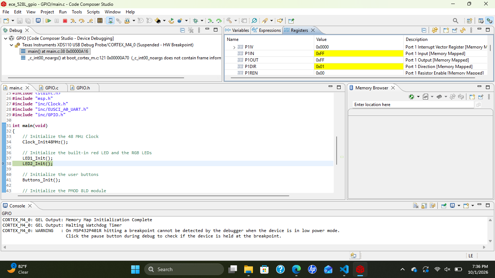
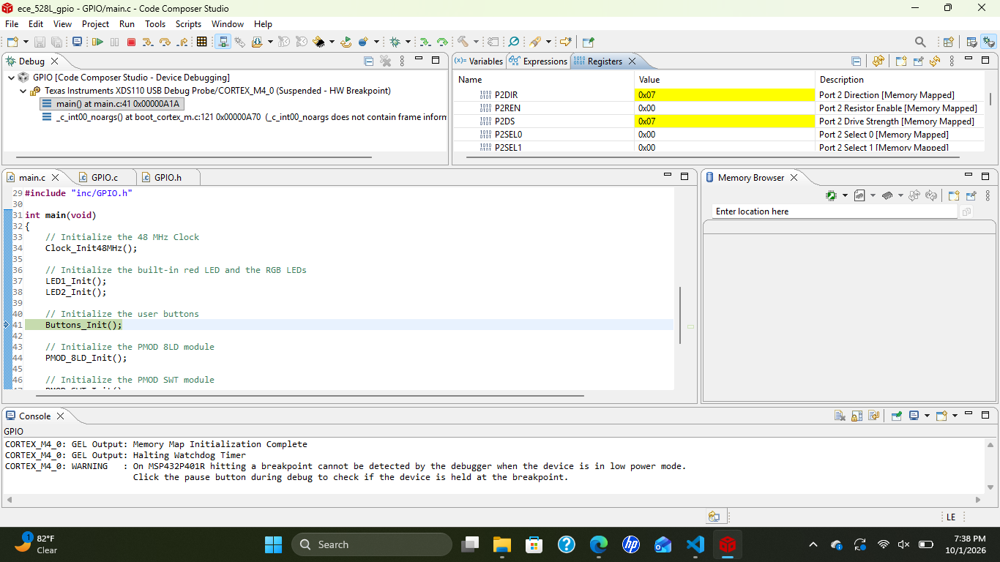
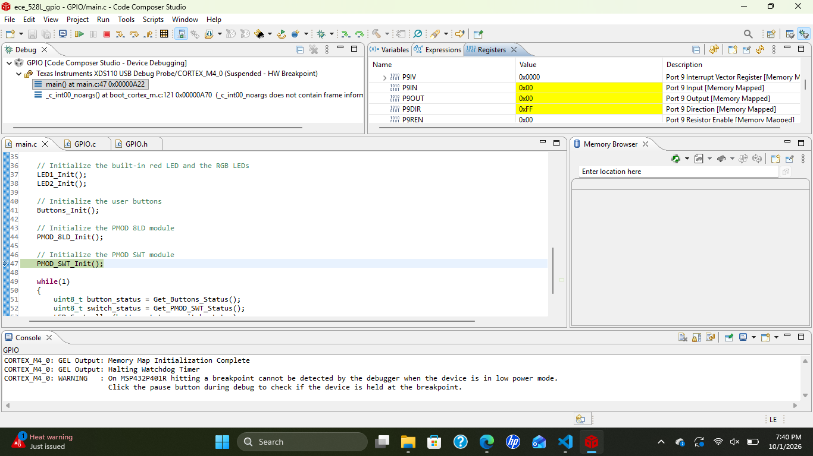
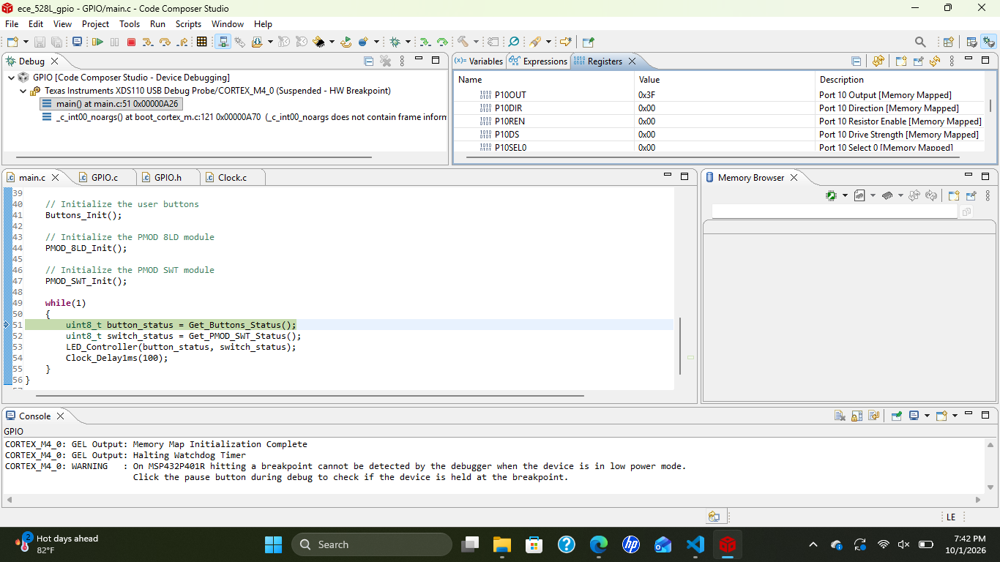

# ECE 528/L - Robotics and Embedded Systems Lab
**CSU Northridge**

**Department of Electrical and Computer Engineering**

## GPIO Lab
The GPIO lab interfaces with the following:

* User buttons and LEDs of the TI MSP432 LaunchPad
* PMOD SWT (4 Slide Switches) - [Product Link](https://digilent.com/reference/pmod/pmodswt/start)
* PMOD 8LD (8 LEDs) - [Product Link](https://digilent.com/shop/pmod-8ld-eight-high-brightness-leds/)

## Overview
This lab introduces the General-Purpose Input/Output interface of the TI MSP432P401R LaunchPad. The built-in user buttons are read as inputs, and the red LED, the RGB LED, and the PMOD 8LD are driven as outputs. The PMOD SWT  is used to select which LED pattern runs. The memory-mapped port registers were also observed in the Code Composer Studio debugger after each initialization function ran.

The following LED patterns were implemented in `GPIO.c` and documented in `GPIO.h`:

| Function | Selected By | Description |
|----------|-------------|-------------|
| `LED_Pattern_1` | All switches off | Button-controlled patterns (modified from the template) |
| `LED_Pattern_2` | SWT1 only | 8-bit binary up counter (template) |
| `LED_Pattern_3` | SWT2 only | LED 1 on, blue RGB LED, 8-bit binary down counter from 255 to 0 (100 ms delay) |
| `LED_Pattern_4` | SWT3 only | Ring counter shifting left, starting at the LSB (200 ms delay) |
| `LED_Pattern_5` | SWT4 only | Ring counter shifting right, starting at the MSB (200 ms delay) |
| `Johnson_Counter` | SWT1 and SWT2 only | 8-bit Johnson (twisted ring) counter with LED 1 on and a green RGB LED (200 ms delay) |

## Components Used
* MSP432 LaunchPad (Texas Instruments) x 1
* USB-A to Micro-USB Cable x 1
* PMOD 8LD (Digilent) x 1
* PMOD SWT (Digilent) x 1

## Analysis and Results

### Register Values
The values below were recorded in the Code Composer Studio debugger by stepping over each initialization function in `main.c`.

| Register | Value | After Running | Meaning |
|----------|-------|---------------|---------|
| `P1DIR` | `0x01` | `LED1_Init` | P1.0 (red LED) is an output |
| `P2DIR` | `0x07` | `LED2_Init` | P2.0, P2.1, and P2.2 (RGB LED) are outputs |
| `P2DS` | `0x07` | `LED2_Init` | High drive strength is enabled for the RGB LED pins |
| `P9DIR` | `0xFF` | `PMOD_8LD_Init` | P9.0 - P9.7 (PMOD 8LD) are all outputs |
| `P10DIR` | `0x00` | `PMOD_SWT_Init` | P10.0 - P10.3 (PMOD SWT) are inputs, so the register is unchanged |

Port 1 (`P1DIR` after `LED1_Init`):

Port 2 (`P2DIR` and `P2DS` after `LED2_Init`):

Port 9 (`P9DIR` after `PMOD_8LD_Init`):

Port 10 (`P10DIR` after `PMOD_SWT_Init`):

### LED Pattern Behavior

`LED_Pattern_1` (all PMOD SWT switches off):

| Input | LED 1 | RGB LED | PMOD 8LD |
|-------|-------|---------|----------|
| Button 1 is pressed | ON | OFF | LEDs 0, 2, 4, 6: ON, LEDs 1, 3, 5, 7: OFF |
| Button 2 is pressed | OFF | BLUE | LEDs 0, 2, 4, 6: OFF, LEDs 1, 3, 5, 7: ON |
| Both buttons are pressed | Toggle every 1 second | GREEN, toggle every 1 second | LEDs 0 - 7: OFF |
| Neither button is pressed | OFF | OFF | LEDs 0 - 7: ON |

Switch-selected patterns:

| Switches Enabled | Function | LED 1 | RGB LED | PMOD 8LD |
|------------------|----------|-------|---------|----------|
| SWT1 only | `LED_Pattern_2` | ON | RED | Binary up counter (0 to 255) |
| SWT2 only | `LED_Pattern_3` | ON | BLUE | Binary down counter (255 to 0), 100 ms per count |
| SWT3 only | `LED_Pattern_4` | OFF | OFF | Ring counter 1, 2, 4, ... 128 (shift left), 200 ms per step |
| SWT4 only | `LED_Pattern_5` | OFF | OFF | Ring counter 128, 64, 32, ... 1 (shift right), 200 ms per step |
| SWT1 and SWT2 only | `Johnson_Counter` | ON | GREEN | 16-step Johnson counter (`0000_0000` up to `1111_1111` and back down to `1000_0000`), 200 ms per step |

## Known Issues or Limitations
The PMOD had a broken LED, so we couldn't show an accurate result. It would work as intended if that LED was fixed.

## References
1. MSP432P401R SimpleLink Microcontroller LaunchPad Development Kit User's Guide
    * [PDF Link](https://www.ti.com/lit/pdf/slau597)

2. MSP432P401R Datasheet
    * [PDF Link](https://www.ti.com/lit/pdf/slas826)

3. Robot Systems Learning Kit (TI-RSLK) User Guide
    * [PDF Link](https://ti.com/lit/pdf/sekp166)

4. MSP432P4xx SimpleLink Microcontrollers Technical Reference Manual
    * [PDF Link](https://www.ti.com/lit/pdf/slau356)

5. PMOD SWT Reference Manual
    * [Reference Manual Link](https://digilent.com/reference/pmod/pmodswt/reference-manual)

6. PMOD LED Reference Manual
    * [Reference Manual Link](https://digilent.com/reference/pmod/pmodled/reference-manual)

7. PMOD 8LD Reference Manual
    * [Reference Manual Link](https://digilent.com/reference/pmod/pmod8ld/reference-manual)
